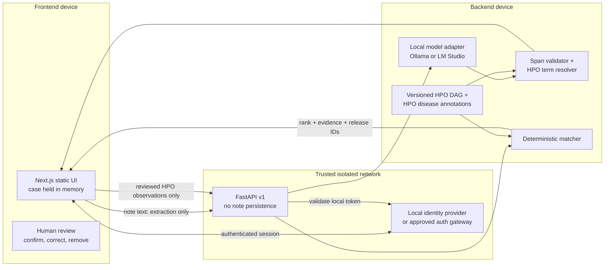

# Phenora architecture review and revised v1

## Scope and test status

The project directory currently contains no application source, so there is no running frontend or backend to execute. This review stress-tests the proposed architecture and defines the interfaces and failure behavior needed before implementation. The OpenAPI contract and model/data manifest schema are the first build artifacts.

The target is a **deployment-shaped prototype**. The current hackathon build scope is backend only: implement the authenticated service, local operation, API, evidence responses, and tests. A future frontend is an API consumer, not part of this build. Use synthetic cases, a smaller pinned model, and a manageable pinned data pack. Model and data are replaceable artifacts selected by manifests/configuration; changing them should not require backend or API changes when they satisfy the same schemas. Run the same compatibility, integrity, performance, and quality gates on any replacement. If the larger artifacts exceed the selected hardware, hardware capacity is a further deployment requirement.

This is architecture readiness, not clinical clearance. The product returns an evidence-backed, deterministic candidate ordering. It does **not** return a diagnosis, a disease probability, or treatment advice. Calling an uncalibrated overlap score a probability would be misleading; a disclaimer alone does not make that output safe. The current FDA CDS navigator specifically treats disease-specific risk probabilities/scores differently from transparent options that support independent clinician review. Regulatory status depends on the actual intended use and jurisdiction, so this document does not establish regulatory clearance. [FDA CDS navigator](https://www.fda.gov/medical-devices/digital-health-center-excellence/step-6-software-function-intended-provide-clinical-decision-support)

### Prototype-to-deployment invariant

| Component | Hackathon profile | Deployment-shaped behavior |
|---|---|---|
| Model | Smaller local model, pinned by ID/version/hash | Replace manifest/config only; same extraction schema, adapter, review UI, and API |
| Data | Curated HPO/HPOA pack, pinned and clearly scoped | Replace versioned data pack/manifest only; same parser, indexes, matcher, and provenance UI |
| Cases | Synthetic fixtures only | Same privacy-safe request path; real notes are not enabled until the site authorizes and validates their use |
| Application/runtime | Full backend API, local-only processing, authentication boundary, audit metadata, offline install; no frontend | Same backend/API; a future client consumes the contract; site identity/network config and capacity must be supplied |
| Output | Ranked evidence candidates | Same output contract; no probabilities or diagnosis claims |

“Only the model and dataset change” is a sound **software compatibility target**. It does not remove the need to evaluate model quality, data coverage, runtime capacity, security configuration, and clinical/regulatory readiness before a real deployment.

## Judgment of the supplied playbook

**Verdict:** a strong, disciplined hackathon blueprint for a synthetic research demo. It is not yet a deployment plan for the stated air-gapped workflow on identifiable pediatric notes. The playbook already gets several important decisions right; the changes below preserve those decisions and close the gap to the new target.

| Playbook content | Judgment | Fix for this project |
|---|---|---|
| Scope and safety boundary (pp. 2, 6, 9, 18–20) | Strong: it says research explorer, synthetic cases, human review, deterministic ranks, and no diagnosis/probability claims. | Keep synthetic-only hackathon inputs and the no-probability boundary. Build the privacy-safe processing path now so synthetic and later authorized notes use the same code path. Change the brief's output wording from “probabilities” to “ranked evidence candidates.” |
| Pipeline and responsibilities (pp. 4, 12–13, 16) | Strong separation: LLM extracts, deterministic code resolves and ranks, clinician reviews, UI exposes evidence. The playbook does include an API contract and mock-first integration. | Its single `/api/analyze-case` example combines raw text, confirmed IDs, and an extraction flag, so the review round-trip is ambiguous. Split extraction, local HPO search, and matching into separate calls. The match call must accept reviewed terms only; this is what the new contract does. |
| Privacy and “offline” (pp. 5, 19–20) | Correctly warns that a local model does not make the whole app offline and calls for network auditing and no case-text logging. | Offline testing is conditional (“if claiming offline”), while air-gapping is central to this project. Make blocked-egress, no-CDN/assets, no telemetry, no note logging/caching, and offline cold-start release gates. A two-device runtime still sends the note across a link; both devices and that link must be inside the approved security boundary. |
| Two-person orchestration (pp. 14–16) | Good role split, bounded tasks, mock fixtures, a schema owner, and integration checkpoints. | It does not define how the two devices reach each other or prevent generated types from drifting. Use the checked-in OpenAPI contract, generated frontend types, backend contract tests, an explicit API address/CORS allowlist, and an isolated integration network. |
| Matching (pp. 6, 9) | Jaccard/coverage is a transparent baseline and is much safer than asking an LLM to rank diseases. | It ignores HPO semantic distance and can over-reward broad/common terms. Keep it as a baseline comparator; use the documented IC/MICA semantic coverage ordering for the prototype. Do not expose either method as a probability. |
| Data acquisition (pp. 8, 19–20) | Strong: real associations, pinned release/license, ID validation, provenance, and a small reproducible slice. The playbook wisely avoids inventing associations. | The exact source/release and disease slice are still open. A 50–200 disease slice can demonstrate mechanics but cannot support broad coverage claims. Show the slice and release in results. Preserve the distinction between explicit HPO `NOT`, zero-frequency evidence, and unreported features. [HPO annotation format](https://obophenotype.github.io/human-phenotype-ontology/annotations/introduction/), [HPO frequency and negative annotations](https://obophenotype.github.io/human-phenotype-ontology/annotations/frequency/) |
| Frontend stack and scope (pp. 2–3, 10–11, 14) | The playbook itself correctly makes 3D, GSAP, charts, and persistence optional or cuttable. | Keep the graph and a textual evidence list. Defer decorative 3D, advanced motion, charts, and extra state libraries until the full extraction-review-match path works. |
| QA and demo gates (pp. 14, 17, 20) | Strong failure checklist: malformed model output, negation, offline API, duplicates, no matches, retries, and restart/demo tests. | Turn the checklist into automated blocking tests, add measured extraction precision/recall and candidate recall@k on a versioned gold fixture set, and make privacy/egress tests mandatory. Do not call synthetic test results clinical validation. |

### Main gaps against the stated target

1. **Scope mismatch:** the playbook explicitly excludes real patient records, hospital integration, and clinical deployment. Keep real notes out of the hackathon demo, but build the deployable-shaped privacy, authentication, and processing boundaries now. Real-note use remains gated on site authorization, privacy/security approval, clinical validation, and regulatory review.
2. **Air-gap is a requirement, not a claim to verify later:** require an offline cold start with outbound traffic blocked and no remote assets/model/data fallback.
3. **The manual review step needs a hard API boundary:** extraction and matching must be separate. Raw note text only reaches the local extraction endpoint; only clinician-reviewed HPO observations reach the matcher.
4. **Pediatric context needs a place in the data model:** retain polarity, temporality, experiencer, and coarse age-at-onset for review. The v1 score does not use age-at-onset until annotation coverage and behavior are evaluated.
5. **Clinical ranking needs evaluation beyond a formula:** define a gold set, measure extraction errors and ranking recall, show coverage limitations, and keep the output ordinal until probability calibration and clinical validation exist.
6. **The headline delay is not universal:** diagnostic time varies by population. A 2024 European survey of 6,507 people across 41 countries reported a 4.7-year average; cite the chosen population and source whenever using a headline figure. [Rare Barometer study](https://pmc.ncbi.nlm.nih.gov/articles/PMC11369105/)

## Target system architecture

The diagram includes a future client to show the stable integration boundary. The hackathon deliverable implements the backend side only; Swagger/HTTP scripts exercise it.

**Trust boundary:** the note leaves the frontend device and reaches the backend device for local extraction. Both devices, the local identity service, and the link between them therefore belong inside the same approved security boundary. Use TLS with a locally trusted certificate, a network allowlist, and authenticated clinician sessions; validate identity locally with no external auth callback. “No cloud” is not the same as “air-gapped.” At runtime, block outbound traffic and remote assets; load the model and data locally. For strict air-gap operation, transfer signed, versioned model/data/dependency bundles by approved offline media. Never silently fall back to a remote model or data source.

### Artifact swap contract

- The extraction adapter always normalizes any supported local model's output to the same mention schema and validates every source span. Model-specific prompt/response parsing stays behind that adapter.
- The data loader accepts one versioned manifest format for HPO ontology and disease annotations. Do not hard-code a maximum disease count into the UI, API, or matcher.
- The model manifest records runtime, model ID/version, digest, supported context limit, and extraction-schema version. The data manifest records ontology/annotation releases, schema version, licenses, hashes, and counts.
- Swapping either manifest changes runtime configuration/provenance, not frontend/backend code or the API contract. The replacement still has to pass integrity, compatibility, extraction/ranking quality, and latency/memory tests on the target devices.
- This is the intended “small hackathon pack/model → larger deployment pack/model” path. If a larger model outgrows backend hardware, hardware is also a required deployment change.

### Data and matching rules

- Ship a manifest that pins the HPO ontology release, HPOA/annotation release, license/attribution, retrieval date, and SHA-256 for each file. HPO releases change over time, so the release is part of every result's provenance. [HPO releases](https://github.com/obophenotype/human-phenotype-ontology/releases)
- Keep the original annotation record attached to each disease–phenotype edge. Normalize stable disease IDs; never use a display label as a key.
- Parse notes into mentions with an exact source quote, zero-based Unicode code-point offsets (end exclusive), polarity (`present`, `negated`, `uncertain`), temporality, experiencer (`patient`, `family_member`, `unknown`), and a coarse onset-age group. The local model proposes mention text/context only; deterministic code resolves HPO candidates.
- Do not rank until the user confirms or edits terms. Family-history observations, uncertain observations, and negated observations are visible but excluded from v1 ranking. Do not treat absent annotations as contradictions. A later version may use explicit HPO `NOT` evidence under a separately reviewed scoring rule.
- V1 ranks only confirmed positive patient observations. For each HPO term `t`, compute information content `IC(t) = -ln((1 + diseases annotated to t or a descendant) / (1 + all diseases))` from the pinned annotation release. For query term `q` and disease annotation term `a`, use Lin semantic similarity `2 * IC(MICA(q,a)) / (IC(q) + IC(a))`, where MICA is the most informative common ancestor in the HPO DAG; the candidate's internal ranking value is the IC-weighted mean of each query term's best similarity to any annotation for that disease. Deduplicate identical terms, skip zero-information terms, and break ties by stable disease ID. This is an uncalibrated similarity used only for ordering. Onset-age group is returned as context but does not affect v1 ranking. Return the method ID and the exact matched annotation/path evidence, but no numeric score or probability. If there is no support, return an empty candidate list and say so.
- A candidate is an **evidence match to a curated dataset**, not proof the patient has the condition. Unmatched means “not matched in this dataset,” never “absent in the patient.”

### Future frontend contract requirements (out of current build scope)

- Provide case entry, extraction status, term review, manual HPO search, results, and an accessible evidence list as the primary experience. The graph is optional and must never be the only way to inspect evidence.
- Before matching, show the source quote beside each extracted term and make polarity, temporality, family-history context, HPO mapping ambiguity, and user confirmation editable.
- Label results “candidate conditions for review” and “ranked phenotype evidence,” never “diagnosis,” “probability,” or “risk.” Show matched terms, annotation references, ontology/data release, ranking method, and known limitations.
- Keep note text and source quotes in volatile page state only. Do not use localStorage, IndexedDB, URL parameters, service-worker caching, remote fonts, CDNs, analytics, or telemetry. Clear the case explicitly and on session expiry.
- Authenticate through the locally reachable identity provider; keep access tokens in memory only. A development/mock identity may be enabled only with synthetic fixtures.
- Handle model unavailable, no matches, ambiguous/unmapped HPO terms, API offline, timeout, incompatible API version, and stale data as distinct states. Manual entry must still work if extraction is unavailable.

### Backend requirements

- FastAPI owns the OpenAPI contract and validates all inputs/outputs. The browser never calls Ollama/LM Studio directly; the model listens on loopback on the backend device.
- Require authenticated clinician authorization for term search, extraction, and matching. Keep `/health` limited to non-sensitive readiness and release status. Record an audit event with actor, time, request ID, action, and model/data manifest IDs, but never note text, quotes, or phenotype lists.
- Split the backend into `extractor`, `span_validator`, `hpo_resolver`, `annotation_repository`, `matcher`, and `api`. No LLM output may set disease candidates, rank, score, or explanation.
- Validate source spans and HPO IDs against the selected local release. Reject stale/unknown IDs instead of guessing. Bound request size, model time, concurrency, and result count.
- Persist no note or case by default. Redact request bodies; do not log note text, extracted quotes, HPO observations tied to a case, or model prompts. Return generic errors with a request ID, not local paths or system details.
- If model/data files are missing, hash-mismatched, or the releases are incompatible, report degraded/unavailable and block ranking. Do not fetch replacements.

## Backend-only implementation and integration plan

The current milestone builds the backend on its own. A test client or future frontend may run on a separate device and call the service only over the approved isolated network.

1. Keep this repository, `contracts/openapi.json`, synthetic fixtures, artifact manifests, and a short decision log in version control. If the development environment itself is air-gapped, use a LAN-only Git remote or approved offline Git bundles. Never put identifiable notes in source control or send them to cloud AI services.
2. Backend owner implements the OpenAPI routes, local identity integration, data pack, resolver, matcher, model adapter, audit writer, and contract tests.
3. Contract changes land first, with a versioned schema and fixture. Backend contract tests validate requests and responses; do not coordinate changes through chat-only descriptions or copy/pasted types.
4. Exercise the service with Swagger/HTTP clients and synthetic cases on loopback. For integration, connect the test client and backend to an isolated LAN with a local identity provider, bounded timeouts, and TLS runtime settings.
5. Package the Python environment, model weights, and HPO files for offline installation. Runtime must not download or resolve dependencies from public registries.
6. Prove artifact replacement by swapping to a second model/data manifest with no source changes, then rerun all gates. This confirms the central prototype-to-deployment requirement.
7. Before any real-record use, require site authorization and separate security, privacy, clinical-validation, and regulatory review. The architecture is designed to carry forward; that review is not replaced by changing model/data packs.

## Architecture stress test

These are tabletop checks against the revised design, not executed application tests because no implementation is present yet.

| Scenario | Required behavior | Result in revised design |
|---|---|---|
| Internet disconnected | Backend, model, HPO data, and API matching still work; no remote fallback | Pass by design; verify with egress blocked |
| Local model stopped | Extraction reports unavailable; manual HPO entry and matching remain usable | Pass by design |
| Note says “no seizures” | Mention remains negated; it cannot silently become a positive match | Pass by design; must test extractor/term review |
| Note describes a parent | Experiencer is family member; excluded from the child's v1 ranking | Pass by design; must test extraction |
| LLM returns invented span or disease name | Span validation rejects unsupported text; diagnosis/ranking fields are not accepted from model | Pass by design; must fuzz parser |
| HPO ID is obsolete/unknown | Resolver marks it unresolved; matcher rejects it | Pass by design |
| Only negative/uncertain/family-history observations are submitted | No positive patient observation can produce a forced candidate | Pass by design; expect `no_candidates` |
| HPO/annotation release missing or hash mismatch | Backend refuses analysis and identifies degraded data status | Pass by design |
| API request/response differs from contract | Backend contract test fails before release | Pass by design; add CI check |
| No disease shares a confirmed term | Empty results with “not matched in this dataset”; no forced top hit | Pass by design |
| Test client disconnects | Backend does not persist the case; later requests cannot recover note content | Pass by design; inspect caches/logging in implementation |
| Two runtime devices use an internet-routed network | System must not claim air-gapped operation | Explicitly blocked by deployment rule |

### Build acceptance gates

1. **Contract gate:** JSON parses; every endpoint has request/response/error schemas; backend contract tests and synthetic HTTP examples pass.
2. **Data gate:** all HPO IDs validate against the pinned ontology; annotation provenance/license/release/hash are visible; no guessed associations.
3. **Matcher gate:** deterministic output for the same profile/data; tested exact and ancestor relationships, duplicates, no matches, negation, uncertainty, and family history; every rank has auditable evidence.
4. **Offline gate:** backend cold-start with network egress blocked; no external DNS/telemetry calls; model and both data releases load locally.
5. **Privacy gate:** test that notes and quotes do not appear in backend logs, caches, persistence, URLs, or crash output; request buffers are discarded.
6. **Identity/audit gate:** unauthenticated requests to case endpoints fail closed; local identity works without Internet; audit metadata contains no PHI.
7. **Artifact-swap gate:** replace model and data manifests without app/API code changes, then pass integrity, compatibility, latency, and quality tests.
8. **Clinical boundary gate:** API has no probability/diagnosis/treatment language; hackathon uses synthetic fixtures; real-note use requires separate site authorization, validation, and regulatory review.

## Current project status

No application source was present when this review began. The current scope is backend only: implement the authenticated local API, artifact manifests, HPO pack loader, model adapter, matcher, and contract/egress gates. Exercise it with Swagger/HTTP clients and synthetic cases; a frontend is a later consumer of the stable API.
