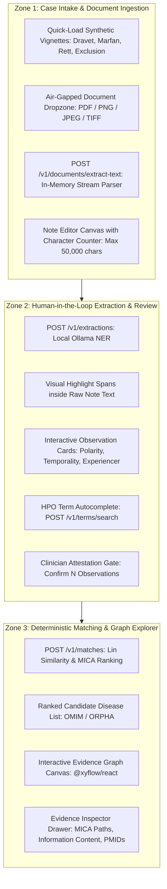

# Phenora Frontend — Architecture & UI/UX Specification

**Document Version:** 1.0.0  
**Status:** Architecture & Design Specification (No code implementation until approved)  
**Target Platform:** Next.js 15+ (App Router), React 19, TypeScript, Tailwind CSS, @xyflow/react (React Flow)  
**Canonical API Contract:** [`contracts/openapi.json`](file:///c:/Users/maury/OneDrive/Desktop/Coding/Phenotype-something%20something/contracts/openapi.json)

---

## 1. Product Vision & Clinical UX Principles

Phenora is an **air-gapped clinical decision-support research interface** for pediatric geneticists and dysmorphologists investigating suspected rare orphan diseases.

### Guiding Principles:
1. **Human-in-the-Loop Trust Boundary:** The local LLM never makes decisions or rankings. It only proposes source text spans. The clinician must explicitly review, adjust, or confirm extracted findings before evidence matching can occur.
2. **Non-Diagnostic Clarity:** Uncalibrated semantic similarity scores are never labeled as "probabilities", "likelihoods", or "diagnoses". The interface displays ordered *phenotype evidence* with transparent paths through the Human Phenotype Ontology (HPO).
3. **Zero Persistence in the Browser:** In keeping with strict air-gapped clinical privacy, no patient note, uploaded document, or clinical finding is ever written to `localStorage`, `sessionStorage`, or `IndexedDB`. All state is ephemeral in volatile React memory and wiped upon session reset or page refresh.
4. **High-Density Clinical Utility:** High legibility, neutral clinical color palette (Slate/Zinc), crisp typography (Inter/Geist with JetBrains Mono for codes/identifiers), accessible contrast (WCAG AAA), and zero generic "AI glow" tropes.

---

## 2. User Journey & Screen Architecture

The UI is structured into three synchronized operational zones:



---

## 3. Detailed Component Hierarchy

```text
frontend/
├── src/
│   ├── app/
│   │   ├── layout.tsx                 # Root layout with air-gap banner and system status
│   │   ├── page.tsx                   # Main 3-panel clinical workbench
│   │   └── globals.css                # Tailwind CSS v4 design tokens
│   ├── components/
│   │   ├── layout/
│   │   │   ├── SystemHeader.tsx       # Provenance (model ID, pack ID, HPO release, air-gap badge)
│   │   │   ├── DisclaimerBanner.tsx   # Persistent FDA CDS non-diagnostic warning banner
│   │   │   └── StatusIndicator.tsx    # Live backend health polling indicator
│   │   ├── intake/
│   │   │   ├── DocumentDropzone.tsx   # Drag-and-drop file uploader for PDF/Image OCR
│   │   │   ├── VignetteSelector.tsx   # Synthetic golden case quick-loader buttons
│   │   │   └── NoteEditor.tsx         # Clinical note textarea with span highlight overlays
│   │   ├── review/
│   │   │   ├── MentionCard.tsx        # Card for each extracted finding with polarity badges
│   │   │   ├── HpoSearchModal.tsx     # Fast debounced search modal for manual HPO term selection
│   │   │   ├── AttributeEditor.tsx    # Dropdowns for temporality, experiencer, onset age
│   │   │   └── AttestationBar.tsx     # Summary of confirmed vs excluded observations + submit
│   │   ├── matching/
│   │   │   ├── CandidateList.tsx      # Ranked disease cards with match score breakdown
│   │   │   ├── CandidateCard.tsx      # Individual disease card with supporting evidence chips
│   │   │   ├── ExcludedObservations.tsx # Foldable tray showing negated/family-history findings
│   │   └── graph/
│   │       ├── EvidenceGraphView.tsx  # React Flow canvas wrapper
│   │       ├── nodes/
│   │       │   ├── ObservationNode.tsx # Patient symptom node (green badge)
│   │       │   ├── MicaNode.tsx        # Most Informative Common Ancestor (blue badge)
│   │       │   └── DiseaseNode.tsx     # Target disease candidate (purple badge)
│   │       ├── edges/
│   │       │   └── EvidenceEdge.tsx    # Custom animated SVG edge with relation label
│   │       └── EvidenceInspector.tsx  # Detail drawer showing Lin math and PubMed references
│   ├── hooks/
│   │   ├── useApi.ts                  # Typed HTTP client wrapper with Bearer auth injection
│   │   ├── useCaseSession.ts          # Ephemeral Zustand store for case lifecycle
│   │   └── useDebounce.ts             # Input debouncer for HPO term search
│   ├── lib/
│   │   ├── api-client.ts              # Generated TypeScript API client from openapi.json
│   │   └── span-utils.ts              # Unicode code-point highlighter & text slicing helpers
│   └── types/
│       └── api.ts                     # TypeScript definitions generated from contracts/openapi.json
```

---

## 4. State Machine & Client-Only Store

The application state lives exclusively in memory via a Zustand store (`useCaseSession`):

| State Phase | Valid Transitions | Data Held in Volatile Memory |
|---|---|---|
| `IDLE` | `DOCUMENT_PARSING`, `NOTE_EDITING` | Selected synthetic fixture or empty note |
| `PARSING_DOC` | `NOTE_EDITING`, `ERROR` | Multipart file bytes, OCR confidence warnings |
| `EXTRACTING` | `REVIEW_REQUIRED`, `ERROR` | Note text, local model prompt request |
| `REVIEW_REQUIRED` | `MATCHING`, `NOTE_EDITING` | Extracted mentions, edited HPO IDs, polarity flags |
| `MATCHING` | `MATCH_COMPLETE`, `ERROR` | Confirmed `ReviewedObservation` list |
| `MATCH_COMPLETE` | `REVIEW_REQUIRED`, `IDLE` | Ranked candidates, graph nodes/edges, provenance |

```typescript
// Architectural sketch of ephemeral Zustand store
interface CaseSessionState {
  noteText: string;
  sourceDocName: string | null;
  ocrWarnings: string[];
  extractionStatus: "idle" | "loading" | "review_ready" | "error";
  mentions: PhenotypeMention[];
  reviewedObservations: Map<string, ReviewedObservation>;
  matchingStatus: "idle" | "loading" | "ranked" | "error";
  matchResponse: MatchResponse | null;
  selectedCandidateId: string | null;
  
  // Actions
  loadVignette: (vignetteId: string) => void;
  setNoteText: (text: string) => void;
  parseDocument: (file: File) => Promise<void>;
  runExtraction: () => Promise<void>;
  updateObservation: (mentionId: string, update: Partial<ReviewedObservation>) => void;
  confirmAllObservations: () => void;
  runMatching: () => Promise<void>;
  selectCandidate: (diseaseId: string | null) => void;
  resetSession: () => void;
}
```

---

## 5. Visual Design Language (Hallmark-Inspired, Anti-Slop)

To avoid generic "AI chatbot" aesthetics, Phenora adheres to rigorous clinical interface design tokens:

- **Surface Palettes:** Neutral Slate (`#0f172a` background for dark, `#f8fafc` for light mode). High contrast border definitions (`#334155` / `#e2e8f0`).
- **Typography:**
  - UI Labels & Narrative: Inter / Geist Sans, `13px` / `14px` for tight information density.
  - Ontology & Diagnostic Codes: JetBrains Mono (`HP:0001166`, `OMIM:154700`) with subtle rounded chip containers.
- **Color Semantics:**
  - **Confirmed Present Phenotypes:** Emerald (`#059669` / `#10b981`)
  - **Negated / Excluded Phenotypes:** Slate muted with strike-through (`#64748b`)
  - **Uncertain / Historical:** Amber (`#d97706`)
  - **HPO Common Ancestors (MICA):** Cyan / Sky (`#0284c7`)
  - **Orphan Disease Candidates:** Violet / Indigo (`#6366f1`)
- **Interaction Constraints:**
  - No flashy particle effects or pulsing neon borders.
  - Hover states reveal exact mathematical evidence (e.g., hover edge -> shows `IC(MICA) = 4.82`).
  - Strict responsive layout: optimized for high-resolution clinical displays (`1920x1080` and `1440x900` laptops).

---

## 6. Implementation Milestones (When Ready to Build)

When authorized to begin building, the frontend will be rolled out in 5 structured steps:

1. **Step 1: Project Scaffolding & API Type Generation**
   - Initialize Next.js 15 project in `frontend/`.
   - Run `openapi-typescript contracts/openapi.json -o frontend/src/types/api.ts`.
   - Setup Tailwind CSS v4 and typography tokens.
2. **Step 2: System Shell & Session Store**
   - Build `SystemHeader` (polling `/v1/health`), `DisclaimerBanner`, and ephemeral Zustand store.
   - Configure local Bearer Token injection from dev token script or auth dialog.
3. **Step 3: Document Intake & Extraction Canvas**
   - Build `DocumentDropzone` with drag-and-drop support calling `/v1/documents/extract-text`.
   - Build `NoteEditor` with character limits and Quick-Load Synthetic Vignette buttons.
   - Connect `POST /v1/extractions` and render live text span highlights.
4. **Step 4: Human-in-the-Loop Review Drawer**
   - Build `MentionCard` list with polarity/temporality toggles.
   - Implement debounced modal calling `POST /v1/terms/search` for manual HPO overrides.
   - Build `AttestationBar` with confirmed observation count gate.
5. **Step 5: Matching Canvas & React Flow Graph**
   - Connect `POST /v1/matches`.
   - Implement `@xyflow/react` canvas with custom `ObservationNode`, `MicaNode`, and `DiseaseNode`.
   - Build `EvidenceInspector` drawer with path tracing and disease detail drawer.
   - End-to-end integration test against the live backend daemon.
