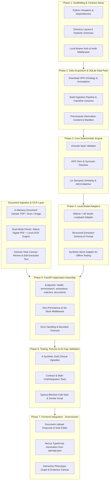

# Phenora Project Phases & Backend Implementation Plan

**Project:** Phenora — Air-Gapped Orphan Disease Phenotype Graph  
**Current Milestone:** Backend Implementation, Local Data Packs & Model Runtime  
**Status:** Ready for Execution  
**Related Specifications:** [PRD.md](./PRD.md) · [TRD.md](./TRD.md) · [APP_FLOW.md](./APP_FLOW.md) · [contracts/openapi.json](./contracts/openapi.json) · [contracts/artifact-manifests.schema.json](./contracts/artifact-manifests.schema.json)

---

## High-Level Project Roadmap

---

## Detailed Phase Breakdown: Backend Completion

### Phase 1: Scaffolding & Contract Setup
**Objective:** Establish the Python development environment, project directory structure, schema definitions mapped 1:1 to `openapi.json`, and local authentication.

- [x] **1.1 Dependency Setup:**
  - Created `backend/pyproject.toml` and `backend/requirements.txt` with pinned versions (`fastapi`, `uvicorn`, `pydantic`, `httpx`, `pytest`, `pyjwt`).
- [x] **1.2 Directory Layout Creation:**
  - `backend/app/{auth,schemas,extractor,span_validator,hpo_resolver,annotation_repository,matcher}`
  - `backend/data_import/`
  - `backend/tests/`
  - `data/packs/`
  - `models/packs/`
  - `fixtures/synthetic_cases/`
  - `scripts/`
- [x] **1.3 Pydantic Schemas:**
  - Implemented request and response models matching [`contracts/openapi.json`](file:///c:/Users/maury/OneDrive/Desktop/Coding/Phenotype-something%20something/contracts/openapi.json) with strict validation:
    - `HealthResponse`, `ErrorResponse`
    - `ExtractionRequest`, `ExtractionResponse`, `MentionCandidate`, `SpanOffsets`
    - `TermSearchRequest`, `TermSearchResponse`, `TermSearchResult`
    - `MatchRequest`, `MatchResponse`, `CandidateCondition`, `EvidencePath`, `GraphData` (`nodes`, `edges`)
- [x] **1.4 Local Bearer Authentication:**
  - Implemented `app/auth/bearer.py`: local JWT decoder with issuer/audience validation.
  - Implemented local development token provider for synthetic testing (`scripts/mint_dev_token.py`).

---

### Phase 2: Data Acquisition & SQLite Data Pack Builder
**Objective:** Ingest official Human Phenotype Ontology and disease-phenotype annotations into a portable, high-performance SQLite data pack with precomputed graph closures and Information Content.

- [x] **2.1 Source Data Ingestion Tooling:**
  - Created `backend/data_import/seed_data.py` and `backend/data_import/build_pack.py` with offline-first pediatric core rare-disease cohort.
- [x] **2.2 SQLite Schema & Transitive Ancestor Closure:**
  - Implemented schema with full indexes: `hpo_term`, `hpo_synonym`, `hpo_edge`, `hpo_ancestor`, `disease`, `disease_annotation`, `term_information_content`.
  - Computed full BFS ancestor closures (`(descendant_id, ancestor_id, distance)`).
- [x] **2.3 Precompute Information Content (IC):**
  - Computed `IC(t) = -ln((1 + diseases_annotated(t_or_descendants)) / (1 + total_diseases))` for all terms.
- [x] **2.4 Artifact Manifest Generation & Repository:**
  - Generated `data/packs/phenora-data-v1/manifest.json` conforming to [`contracts/artifact-manifests.schema.json`](file:///c:/Users/maury/OneDrive/Desktop/Coding/Phenotype-something%20something/contracts/artifact-manifests.schema.json).
  - Built `backend/app/annotation_repository/repository.py` for read-only indexed queries and MICA calculations.

---

### Phase 3: Deterministic Core Engine Implementation
**Objective:** Build the deterministic algorithms that ensure medical safety, eliminate hallucinations, and provide fully transparent, auditable evidence.

- [x] **3.1 Unicode Span Validator (`app/span_validator/`):**
  - Implemented zero-based Unicode code-point offset extraction and quote verification in `backend/app/span_validator/validator.py`.
- [x] **3.2 HPO Term & Synonym Resolver (`app/hpo_resolver/`):**
  - Fast indexed lookup across canonical labels and synonyms in SQLite.
  - Returns `exact`, `synonym`, `ambiguous`, or `unmapped` status in `backend/app/hpo_resolver/resolver.py`.
- [x] **3.3 Lin Semantic Similarity & MICA Matcher (`app/matcher/`):**
  - Implemented in `backend/app/matcher/matcher.py`:
    - Strict exclusion rules for negated, uncertain, family-history, and historical observations.
    - Most Informative Common Ancestor (MICA) discovery.
    - Lin semantic similarity: `2 * IC(MICA(q, a)) / (IC(q) + IC(a))`.
    - IC-weighted mean ranking score and stable tie-breaking by disease ID.
    - Graph assembly (`nodes`, `edges`) connecting phenotypes to candidate diseases.
    - Explicit `no_candidates` status when no positive support exists.

---

### Phase 4: Local Model Integration (NER Extractor)
**Objective:** Connect to local offline language models running on loopback (Ollama / LM Studio) constrained strictly to entity extraction.

- [x] **4.1 Base Extractor Interface (`app/extractor/base.py`):**
  - Defined `BaseExtractor` abstract interface, `RawMention` model, and failure exceptions (`ModelUnavailableException`, `ModelTimeoutException`).
- [x] **4.2 Loopback Adapters (`app/extractor/`):**
  - `OllamaAdapter`: Connects to `http://127.0.0.1:11434/api/generate` with strict JSON extraction format and 30s timeout.
  - `LMStudioAdapter`: Connects to `http://127.0.0.1:1234/v1/chat/completions` with JSON mode.
- [x] **4.3 Offline Mock Extractor (`app/extractor/mock.py`):**
  - High-speed deterministic regex/dictionary extractor for offline tests, CI/CD, and environments without an active GPU daemon.
- [x] **4.4 Model Pack Manifest & Pipeline Service:**
  - Created `models/packs/phenora-model-v1/manifest.json` conforming to [`contracts/artifact-manifests.schema.json`](file:///c:/Users/maury/OneDrive/Desktop/Coding/Phenotype-something%20something/contracts/artifact-manifests.schema.json).
  - Built `backend/app/extractor/service.py` (`ExtractionService`) connecting extractor + span validator + HPO resolver into typed `ExtractionResponse`.

---

### Phase 5: FastAPI Application Assembly & Security Hardening
**Objective:** Assemble the routes, apply strict zero-persistence privacy rules, and configure local network defenses.

- [x] **5.1 Endpoints Implementation (`app/main.py`):**
  - `GET /v1/health`: Returns 200 with active pack IDs and releases, or 503 if data pack is corrupt/missing.
  - `POST /v1/terms/search`: Searches HPO terms/synonyms in SQLite via request body (no terms in URLs).
  - `POST /v1/extractions`: In-memory note extraction, span validation, and candidate HPO mapping.
  - `POST /v1/matches`: Clinician-reviewed observations matching, Lin similarity ranking, graph assembly.
- [x] **5.2 Zero-Persistence & Privacy Middleware:**
  - Injected `Cache-Control: no-store` on all responses.
  - Implemented request logging sanitizer: completely stripped request bodies, clinical notes, and quotes from logging.
  - Non-PHI audit logging: records only `actor_id`, `timestamp`, `route`, `request_id`, `status_code`, and `pack_ids`.
- [x] **5.3 Error Handling & Limits:**
  - Max note length enforcement (50,000 characters; returns 413 `payload_too_large`).
  - Standardized error schema (`request_id`, `code`, `message`).
- [ ] **5.4 Air-Gapped Document Ingestion & Local OCR (`app/document_parser/`):**
  - **Strategy & Architectural Gate:** Enable direct document ingestion (scanned notes, clinical referral PDFs, lab images) at the entry point of the pipeline rather than requiring manual text entry.
  - **In-Memory Zero Persistence:** Uploaded files (`application/pdf`, `image/png`, `image/jpeg`, `image/tiff`) stream strictly into RAM (`io.BytesIO`); never saved to disk, temp folders, or logged.
  - **Dual-Engine Processing:**
    1. *Native Digital PDF Parser (`pypdf` / `pymupdf`):* Extracts pristine embedded text streams in <100ms with zero OCR character degradation.
    2. *Local Air-Gapped OCR Fallback (`pytesseract` / `rapidocr_onnxruntime`):* Extracts text from scanned PDFs and clinical images completely offline.
  - **Pre-NER Clinician Verification:** Extracted text is returned to the client canvas for clinician inspection and correction *prior* to triggering NER extraction, ensuring OCR errors (e.g., dosage numbers, letter substitutions) do not pollute ontology resolution.
  - **Endpoint:** `POST /v1/documents/extract-text` with payload bounds (25 MB max) and `Cache-Control: no-store`.

---

### Phase 6: Testing, Fixtures & Air-Gap Verification
**Objective:** Validate the implementation with gold-standard pediatric cases, regression tests, and cold-start air-gap enforcement.

- [x] **6.1 Synthetic Gold Vignettes (`fixtures/synthetic_cases/`):**
  - Case 1 (Dravet Syndrome): Fever-induced seizures, developmental plateau, ataxia (`case_01_dravet.json`).
  - Case 2 (Marfan Syndrome): Arachnodactyly, pectus excavatum, ectopia lentis (`case_02_marfan.json`).
  - Case 3 (Exclusion / Negation Test): Multiple negated findings ("no seizures"), family history only (`case_03_exclusion.json`).
  - Case 4 (Rett Syndrome): Developmental regression, hand stereotypy, microcephaly, absent speech (`case_04_rett.json`).
- [x] **6.2 Automated Test Suite (`backend/tests/`):**
  - Built comprehensive 45-test suite covering schemas, auth, HPO closures, Lin math, MICA discovery, extraction pipelines, and golden vignettes.
- [x] **6.3 Air-Gap Verification Script (`scripts/verify_airgap.py`):**
  - Cold-start test with socket connections blocked outside loopback; verified zero external network requests.
- [x] **6.4 End-to-End API Smoke Script (`scripts/api_smoke.py`):**
  - Validated complete workflow: Health check -> Token authentication -> Extraction -> Review -> Match -> Graph verification.

---

### Phase 7: Frontend Clinical Workbench & Evidence Canvas [COMPLETED]
**Objective:** Deliver an air-gapped, high-density clinical research interface with interactive evidence graph rendering.

- [x] **7.1 TypeScript Type Generation & Client:**
  - Created [`frontend/src/types/api.ts`](file:///c:/Users/maury/OneDrive/Desktop/Coding/Phenotype-something%20something/frontend/src/types/api.ts) matching 1:1 with `contracts/openapi.json`.
  - Built typed API client wrapper in [`frontend/src/lib/api.ts`](file:///c:/Users/maury/OneDrive/Desktop/Coding/Phenotype-something%20something/frontend/src/lib/api.ts) with Bearer token authentication.
- [x] **7.2 Case Intake & Ingestion Layer:**
  - One-click synthetic golden case loader (`Dravet`, `Marfan`, `Exclusion`, `Rett`) in [`frontend/src/components/GoldVignettes.tsx`](file:///c:/Users/maury/OneDrive/Desktop/Coding/Phenotype-something%20something/frontend/src/components/GoldVignettes.tsx).
  - In-memory document dropzone ([`frontend/src/components/DocumentDropzone.tsx`](file:///c:/Users/maury/OneDrive/Desktop/Coding/Phenotype-something%20something/frontend/src/components/DocumentDropzone.tsx)) supporting PDF and scanned images with zero disk persistence.
  - Clinical note editor canvas ([`frontend/src/components/NoteEditor.tsx`](file:///c:/Users/maury/OneDrive/Desktop/Coding/Phenotype-something%20something/frontend/src/components/NoteEditor.tsx)) with live 50,000 char boundary.
- [x] **7.3 Human-in-the-Loop Review Gate:**
  - Implemented [`frontend/src/components/MentionReviewer.tsx`](file:///c:/Users/maury/OneDrive/Desktop/Coding/Phenotype-something%20something/frontend/src/components/MentionReviewer.tsx): source span quotes, polarity (`present`, `negated`, `uncertain`), experiencer, temporality, and confirmation toggles.
  - Implemented debounced HPO search modal ([`frontend/src/components/HpoSearchModal.tsx`](file:///c:/Users/maury/OneDrive/Desktop/Coding/Phenotype-something%20something/frontend/src/components/HpoSearchModal.tsx)) querying `/v1/terms/search`.
- [x] **7.4 Deterministic Evidence Graph & Inspector:**
  - Interactive `@xyflow/react` node-link graph ([`frontend/src/components/EvidenceGraphView.tsx`](file:///c:/Users/maury/OneDrive/Desktop/Coding/Phenotype-something%20something/frontend/src/components/EvidenceGraphView.tsx)) with custom observation, MICA, and disease nodes in a 3-column hierarchical layout.
  - Ranked candidate disease cards ([`frontend/src/components/CandidateList.tsx`](file:///c:/Users/maury/OneDrive/Desktop/Coding/Phenotype-something%20something/frontend/src/components/CandidateList.tsx)) with click-to-filter capability.
  - Deep evidence inspector and excluded findings tray ([`frontend/src/components/EvidenceInspector.tsx`](file:///c:/Users/maury/OneDrive/Desktop/Coding/Phenotype-something%20something/frontend/src/components/EvidenceInspector.tsx)).
- [x] **7.5 Production Integration & Air-Gapped Serving:**
  - Built optimized static bundle (`frontend/dist`) with Vite and Tailwind CSS.
  - Mounted directly in FastAPI at `http://127.0.0.1:8000/` for instant one-port execution.
