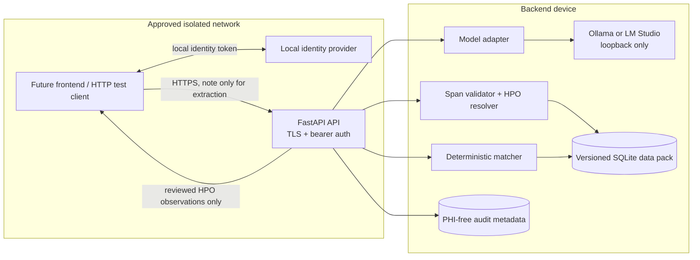

# Phenora Backend — Technical Requirements Document

**Version:** 0.1  
**Status:** Hackathon backend-only implementation baseline  
**Related docs:** [PRD](./PRD.md) · [App flow](./APP_FLOW.md) · [Architecture review](./ARCHITECTURE_REVIEW.md) · [OpenAPI contract](./contracts/openapi.json)

## 1. Technical objective

Implement the deployment-shaped backend now. The hackathon profile supplies synthetic cases, a compact local extraction model, and a curated versioned HPO disease-annotation pack. Larger compatible model/data packs are activated by manifest/configuration without changing backend or API code. A pack swap still requires integrity, quality, performance, and provenance checks. A future frontend consumes the API contract but is outside this build.

This is not clinical clearance. Use synthetic cases for the hackathon; real-note use requires site authorization plus separate privacy, security, clinical-validation, and regulatory review.

## 2. System context



**Runtime boundary:** the API consumer, backend device, local identity provider, and their link form one approved security boundary. During the hackathon, the consumer is Swagger/HTTP client scripts and uses synthetic cases. A later frontend may run on another device; if policy does not permit notes to leave the clinician's workstation, deploy the client and backend on that workstation. Runtime services must have no Internet route, no cloud inference, no telemetry, and no remote data fallback.

## 3. Components and ownership

| Component | Responsibility | Must not do |
|---|---|---|
| API gateway/FastAPI | Authenticate/authorize, validate requests, coordinate extraction/resolution/matching, return typed and graph-ready results | Persist note text; log request bodies; expose local file paths; silently fetch remote assets/data |
| API client/test harness | Exercise the documented backend endpoints with synthetic cases; simulate the human review step between extraction and matching | Become a product UI; submit extracted terms as reviewed without confirmation |
| Local identity adapter | Validate JWTs from the approved in-network identity provider; map authorized users/roles | Contact public identity endpoints or accept the development identity for non-synthetic use |
| Document parser / Local OCR | Parse digital PDFs (`pypdf`/`pymupdf`) and run local OCR (`pytesseract`/`rapidocr`) on images/scans in RAM | Write uploaded files to disk or temp folders; call cloud OCR APIs; log file contents |
| Model adapter | Call one configured local runtime, normalize output to `phenotype-extraction-v1`, record model manifest identity | Emit diagnoses/ranks; invent HPO IDs as authoritative; fall back remotely |
| Span validator | Verify quote and offsets against the exact input note; reject unsupported spans | Accept model-generated quotes that do not match the source |
| HPO resolver | Resolve labels/synonyms against local pinned ontology; return exact/synonym/ambiguous/unmapped | Guess IDs or silently map obsolete terms |
| Annotation repository | Load versioned disease annotations and provenance from local pack | Change pack silently or interpret unreported terms as absent |
| Matcher | Rank only confirmed positive patient observations deterministically | Consume raw note text or LLM disease scores |
| Audit writer | Record actor, timestamp, request ID, action, and model/data manifest IDs | Record notes, quotes, HPO observation lists, patient identifiers, or prompt text |

## 4. Recommended backend stack

- **API:** Python, FastAPI, and Pydantic. Keep extraction, span validation, HPO resolution, annotation repository, matching, auth, audit, and API schemas in separate modules.
- **Local model:** one selected local runtime (Ollama or LM Studio) behind `ModelAdapter`. The runtime listens on loopback on the backend device. Pin the model and record its digest.
- **Local data:** SQLite pack for normalized terms, ontology edges/closure, diseases, and annotations. Load the small HPO DAG and required indexes from the same versioned pack. Do not add Neo4j or a remote graph service for the prototype.
- **API exploration/testing:** checked-in OpenAPI, Swagger UI on the local service, Python unit/contract tests, HTTP smoke scripts, and network-egress audit on the backend/integration setup.

There is no frontend, graph canvas, browser state, or case-history persistence in this backend-only milestone. Return evidence in a form a future client can render.

## 5. Repository layout

```text
contracts/
  openapi.json
  artifact-manifests.schema.json
backend/
  app/main.py
  app/auth/
  app/extractor/
  app/span_validator/
  app/hpo_resolver/
  app/annotation_repository/
  app/matcher/
  app/schemas/
  data_import/
  tests/
data/
  raw/                 # staging only; not loaded at runtime
  packs/<pack-id>/      # SQLite pack + manifest + checksums
models/
  packs/<pack-id>/      # model artifacts + manifest
fixtures/
  synthetic_cases/
  expected_results/
scripts/
  api_smoke/
```

Never commit patient notes or model weights. Keep raw data staging separate from the runtime pack; runtime reads only verified packs.

## 6. API contract

`contracts/openapi.json` is the canonical external interface. No frontend is built in this milestone. Swagger/HTTP test scripts and backend contract tests exercise the API; a future frontend can generate TypeScript types from the same file.

| Route | Auth | Purpose | Content rule |
|---|---|---|---|
| `GET /v1/health` | No bearer token; exposes readiness/artifact identifiers only | Report local readiness, active model/data pack IDs, and releases | No OS details, paths, user data, or model prompts |
| `POST /v1/documents/extract-text` | Required | Parse uploaded PDF or image via native text extraction or local OCR | Multipart file processed in memory only; zero disk/log persistence; `no-store` |
| `POST /v1/terms/search` | Required | Search local HPO labels/synonyms for manual entry | Query in JSON body, never URL; body logging disabled |
| `POST /v1/extractions` | Required | Send note to local extractor and return reviewed-mention candidates | Note processed in memory, response `no-store`, no persistence/logging |
| `POST /v1/matches` | Required | Rank reviewed HPO observations | Schema forbids raw note text; only reviewed IDs/context |

All case endpoints require bearer authentication. Runtime tokens come from an identity provider reachable inside the isolated network. A development/mock identity is accepted only when the active profile is explicitly synthetic-only. Use TLS in runtime. CORS is a future-browser integration setting and is not authentication. API details and error payloads are defined in the OpenAPI file.

### Request/response invariants

- Extraction returns a request ID, model provenance, ontology release, source-grounded mentions, context, resolver state, and HPO candidates.
- Source offsets are zero-based Unicode code-point indexes, end-exclusive. `quote` must equal the exact note substring at those offsets.
- Matching input requires a reviewed status for every observation. It carries HPO IDs, polarity, temporality, experiencer, onset-age group, and optional source mention IDs; it contains no note text.
- Match output includes ordinal ranks, supporting observation IDs, HPO terms/paths, annotation provenance, release/hash, excluded/unmatched observations, and graph-ready `nodes`/`edges` derived from returned evidence. It contains no numeric probability or similarity score.
- Every response involving a case uses `Cache-Control: no-store`. Errors never echo request content.

## 7. Data pack and HPO handling

### Sources and pack build

Use official HPO ontology data plus a selected versioned HPO disease-phenotype annotation source (HPOA/Orphadata as appropriate). Record source URL, release, retrieval date, license/attribution, counts, and SHA-256. Check each source's terms independently. The manifest schema is `contracts/artifact-manifests.schema.json`.

Pack build steps:

1. Download or receive source files in an approved staging environment; do not fetch them at runtime.
2. Verify checksums and preserve source files separately from normalized runtime data.
3. Parse stable disease IDs, labels, HPO IDs, labels, ontology edges, synonyms, evidence codes, references, frequencies, and explicit `NOT` annotations.
4. Reject/flag obsolete or unknown HPO IDs; remove duplicates deterministically and report counts.
5. Build indexed SQLite tables and precomputed ancestor closure/information content for the pack.
6. Write `phenora-data-v1` manifest with ontology and annotation releases, scope, selection method, counts, file hashes, and licenses.
7. Run data-integrity and fixture tests before activating the pack.

### SQLite tables and indexes

- `hpo_term(hpo_id PRIMARY KEY, label, obsolete, replacement_id)`
- `hpo_synonym(hpo_id, synonym, synonym_type)` with a normalized lookup index
- `hpo_edge(child_id, parent_id, relation)` with indexes on both IDs
- `hpo_ancestor(descendant_id, ancestor_id, distance)` with indexes on both IDs
- `disease(disease_id PRIMARY KEY, label, source_id)`
- `disease_annotation(disease_id, hpo_id, polarity, frequency, evidence_code, reference, source_release)` with indexes on `hpo_id` and `disease_id`
- `term_information_content(hpo_id PRIMARY KEY, ic_value, annotation_disease_count)`

Preserve annotation provenance. An absent positive annotation is “not reported/not matched,” not a contradiction. V1 displays explicit `NOT` metadata if present but does not use it as a ranking penalty. Zero-frequency cohort observations are not interchangeable with expert `NOT` annotations.

## 8. Model pack and extraction

The `phenora-model-v1` manifest pins local runtime, model ID/version, weights digest, extraction schema version, supported languages, input/timeout/memory limits, and files. Only one runtime is selected per profile.

Extractor output contains:

- mention text and exact source quote/span
- polarity: `present`, `negated`, or `uncertain`
- temporality: `current`, `historical`, `onset`, or `unknown`
- experiencer: `patient`, `family_member`, or `unknown`
- coarse onset-age group; use `unknown` unless stated in the note
- zero to five deterministic HPO resolver candidates with match kind

Model output cannot set authoritative HPO IDs, disease suggestions, score, or ranking. The adapter enforces a constrained structured format; Pydantic validates it; the span validator confirms the quote and offset; then the resolver maps the phrase locally. Malformed/unsupported output fails safely into manual mode.

## 9. Matching algorithm

V1 ranks only confirmed, positive observations whose experiencer is the patient. Negated, uncertain, historical, unknown-experiencer, and family-history observations are returned as excluded context. Coarse onset-age group is retained in the profile and API response but does not affect v1 ranking.

For each HPO term `t`, compute information content from the active annotation pack:

```text
IC(t) = -ln((1 + unique diseases annotated to t or its descendants)
            / (1 + all diseases in the pack))
```

For observed term `q` and disease annotation term `a`, compute Lin similarity using the most informative common ancestor `MICA(q,a)`:

```text
similarity(q,a) = 2 * IC(MICA(q,a)) / (IC(q) + IC(a))
support(q,disease) = max similarity(q,a) over annotations a for that disease
rank_value(disease) = IC-weighted mean of support(q,disease) over confirmed q
```

Deduplicate identical IDs, omit zero-information query terms, and break ties by stable disease ID. The internal value only orders candidates and is not returned in the API. Candidate evidence includes exact/ancestor/shared-ancestor relation, HPO paths, annotation source/reference, and data release. If no candidate has positive support, return `no_candidates`.

## 10. Security, privacy, and air-gap controls

- **Network:** private isolated LAN; backend firewall allows only required API clients and local identity traffic; no Internet route at runtime. Block outbound egress during acceptance testing.
- **Transport:** TLS using a certificate trusted inside the isolated environment. Runtime bearer tokens are validated against local identity keys; no public issuer/JWKS lookup.
- **Authorization:** case endpoints require an authenticated clinician role. Administrative pack activation is restricted to an authorized operator and is not exposed through clinician routes.
- **API client boundary:** extraction/match responses use `Cache-Control: no-store`; API never returns or persists more source text than extraction review requires. A future browser must avoid localStorage/IndexedDB/service-worker caching, remote assets, analytics, URL note content, and persisted tokens.
- **Backend:** body logging disabled; no note/prompt/span/phenotype content in application, proxy, model-runtime, crash, or audit logs. Use request IDs and generic error messages.
- **Audit:** record actor ID, timestamp, route/action, request ID, model/data pack IDs, and outcome code only. Do not include patient identifiers or phenotype lists.
- **Storage:** no case persistence in v1. Model/data packs are read-only during inference.
- **Updates:** offline signed/checksummed bundles; validate before activation; maintain a known-good previous pack for rollback; never auto-download a replacement.
- **Development:** use synthetic fixtures only. Do not put PHI in version control, issue trackers, cloud AI tools, or shared test artifacts.

## 11. Backend development and runtime

- Backend owner implements OpenAPI routes, local auth integration, model/data adapters, resolver, matcher, and audit writer.
- Use synthetic notes against loopback during development. If the development network is air-gapped, use a LAN-only Git remote or approved offline Git bundles.
- During backend integration, an HTTP client/Swagger UI obtains a development token from the local test identity provider and calls the service on an isolated network.
- For runtime, the backend device hosts FastAPI, local model runtime, versioned SQLite pack, and audit metadata. The identity provider is reachable only on the approved network.
- Bound request/model timeouts, connection limits, request sizes, and result counts. A future browser client must use TLS and a configured origin allowlist.
- Verify that a submitted note reaches only the backend/model on the approved local path; otherwise run client and backend on the same workstation.

## 12. Replaceable pack activation

For the model or data pack change, without a code change:

1. Stage the new pack offline.
2. Validate manifest schema, hashes, licenses, release compatibility, IDs, and counts.
3. Run extraction or matcher golden tests and performance/memory benchmarks on target hardware.
4. Activate by pack ID/configuration; restart or hot-load through a controlled activation operation.
5. Confirm `/v1/health` and extraction/match responses report the new release and manifest IDs.
6. Keep rollback to the previous known-good pack.

Never silently accept a pack just because the file is larger or loads successfully. Model output quality and dataset coverage can change when artifacts change.

## 13. Failure behavior

| Failure | Backend behavior | API consumer/test-harness behavior |
|---|---|---|
| Invalid/missing token | 401/403; no processing | Obtain a valid local token; no case request is retried anonymously |
| Model unavailable/timeout | Explicit error; no remote fallback | Call manual term search and matching endpoints if local data is ready |
| Invalid model JSON/span | Reject extraction result; safe error code | Do not treat rejected output as reviewed observations |
| Ambiguous/unmapped term | Return status and suggestions; do not guess | Resolve via local term search or omit the observation |
| Unknown/obsolete HPO ID | Reject or mark unresolved | Correct the request using the active ontology release |
| Data missing/hash mismatch | Mark unavailable and block matching | Stop; do not use stale/remote pack |
| No candidate support | Return `no_candidates` | Display the explicit no-match result |
| API/client timeout | Bounded processing; no content echoed | Retry only after explicit caller decision; do not replay silently |
| Request ends or caller discards it | Discard volatile request state | Client discards note/excerpts; backend has no case to clear |

## 14. Test and release gates

- **Contract:** all API inputs/outputs validate against OpenAPI; HTTP examples and fixtures conform; extra fields are rejected.
- **Extraction:** four or more synthetic benchmark cases; exact spans; valid JSON; unsupported additions; negation; family history; temporality; onset age; malformed output and timeouts.
- **Matcher:** exact/HPO ancestor/common-ancestor relationships; duplicate and broad terms; excluded observations; unknown IDs; stable ties; no matches; every candidate has evidence.
- **Data:** hashes, schema, all IDs, duplicates, obsolete terms, release/license provenance, and selected subset counts.
- **Identity/security:** unauthenticated calls fail; local identity works offline; authorization and audit are tested; logs contain no case content.
- **Offline:** cold start with outbound traffic blocked; inspect DNS/network logs for remote calls; confirm local API/model/data and manual matcher path.
- **Artifact swap:** second compatible model and data manifests activate without app/API code changes; rerun quality and performance checks.
- **API workflow:** extraction output is reviewed by the caller before matching; candidate evidence is graph-ready; data/model provenance is visible; no case is persisted.
- **Demo:** run the same synthetic API workflow twice back-to-back; keep a precomputed synthetic response fixture clearly labeled.

## 15. Deployment-readiness boundary

The prototype is deployment-shaped when the above components and gates exist. A larger model/data pack should be a manifest-level swap. Real clinical operation still requires local site authorization, clinical performance validation, security/privacy approval, regulatory review, and confirmation that target hardware and the isolated network meet requirements. These are release approvals, not model/data configuration changes.
